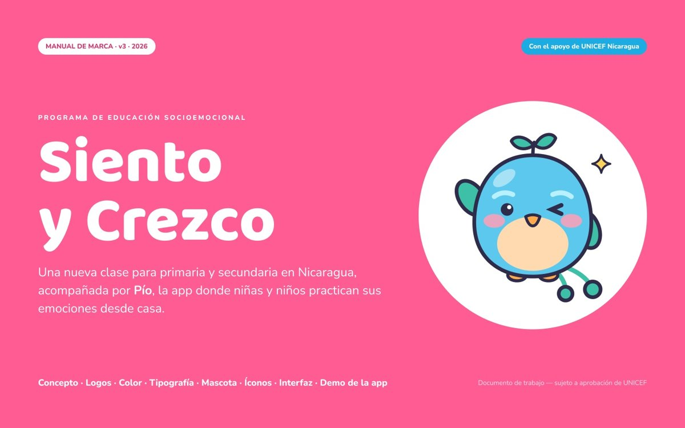
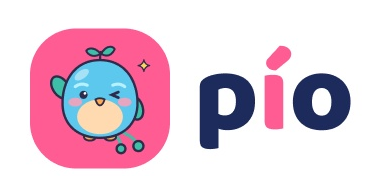
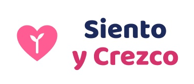
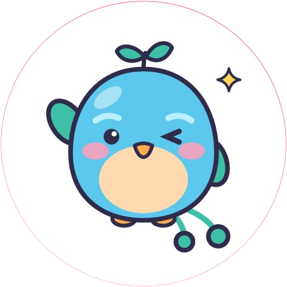
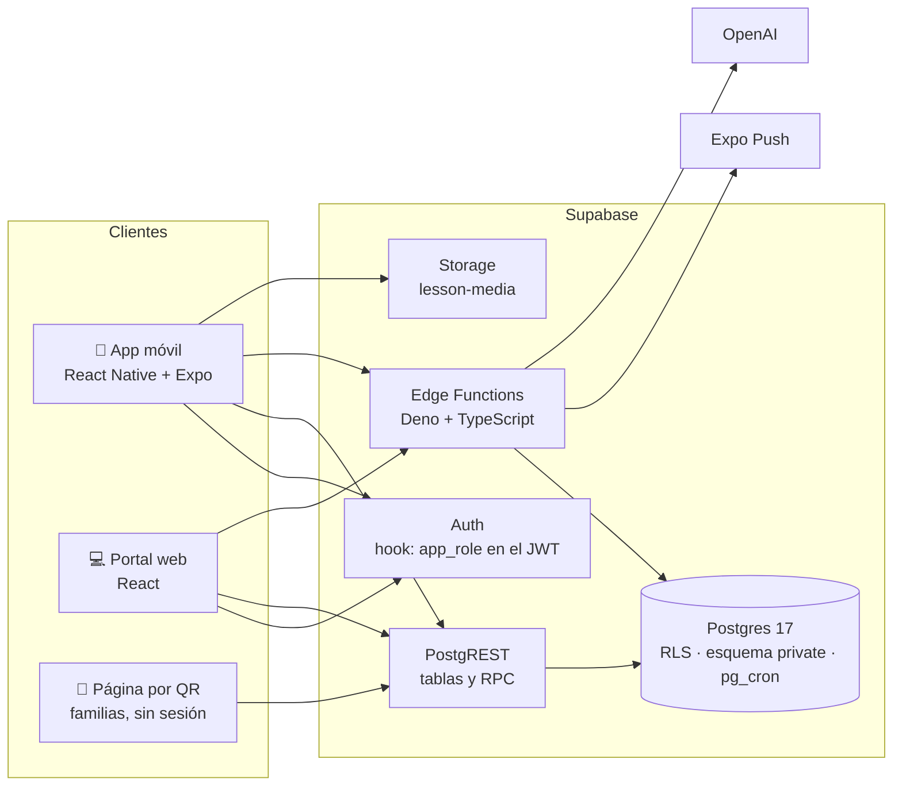

<div align="center">



<br />
<br />


&nbsp;&nbsp;&nbsp;&nbsp;


<h1>pio-backend</h1>

<p><b>API de Pío</b>, la app de <b>Siento y Crezco</b>: educación socioemocional para primaria y secundaria en Nicaragua.<br />
<i>"Aprendo a sentir, un día a la vez."</i></p>

<p>
  <a href="https://github.com/daamaleman/pio-backend/actions/workflows/db-tests.yml"></a>
  
  
  
  
  
</p>

<p>
  <a href="#-qué-es-pío">Qué es</a> ·
  <a href="#-módulos">Módulos</a> ·
  <a href="#-arquitectura">Arquitectura</a> ·
  <a href="#-inicio-rápido">Inicio rápido</a> ·
  <a href="#-seguridad-y-privacidad">Privacidad</a> ·
  <a href="#-pruebas">Pruebas</a> ·
  <a href="#-despliegue">Despliegue</a> ·
  <a href="#-equipo">Equipo</a>
</p>

</div>

<br />

## 💗 Qué es Pío



**Siento y Crezco** es una nueva clase de educación socioemocional: *"yo siento"* (reconozco mis emociones) *"y crezco"* (aprendo a regularlas, a respetar y a convivir). La acompaña **Pío**, un guardabarranco, el ave nacional de Nicaragua, que guía a niñas, niños y adolescentes en la app.

Una vez por semana la docente da la clase y asigna una **lección semanal**: un cuento, conceptos, mini-juegos y un reto en casa. El estudiante la hace en el celular de la familia, incluso **sin conexión**, siembra una flor en **Mi jardín** y gana sellos. La docente ve el avance y el **clima emocional** de su grupo, siempre agregado y sin exponer a nadie. Si alguien podría necesitar apoyo, recibe una **alerta**.

Este repositorio es el **backend**: base de datos, reglas de seguridad, funciones y pruebas sobre **Supabase**. Lo usan la app móvil (React Native + Expo) y el portal web (React). Es un proyecto de la **Jornada Académica y Social por los Derechos de la Niñez y Adolescencia** (Universidad Americana – UNICEF Nicaragua, 2026), en la temática *apoyo a la salud mental de niñas, niños y adolescentes*.

<br clear="right" />

## 🧩 Módulos

<table>
  <tr>
    <td width="33%" valign="top">
      <h3>🔐 Acceso</h3>
      Código de clase + PIN de 4 dibujos (primaria) o dígitos (secundaria). Login del personal con correo. Roles en el JWT. Restablecer PIN, importar estudiantes desde Excel e invitar personal por correo.
    </td>
    <td width="33%" valign="top">
      <h3>📚 Lecciones</h3>
      Lección semanal de 12–13 pasos en partes. Contenido JSON versionado por lengua y validado contra su estructura. Medios en Storage con URLs firmadas.
    </td>
    <td width="33%" valign="top">
      <h3>🌱 Progreso</h3>
      Check-in diario de emociones, avance por paso sin conexión (<code>sync_progress</code>, idempotente), indicadores calculados en el servidor, flores, sellos y tarjetas que nunca se pierden.
    </td>
  </tr>
  <tr>
    <td valign="top">
      <h3>👩‍🏫 Docente y dirección</h3>
      Panel del grupo, asignaciones, progreso por indicador sin notas, clima semanal agregado, alertas de apoyo y panel de la escuela solo con números.
    </td>
    <td valign="top">
      <h3>🤝 Bienestar</h3>
      Encuesta anónima del grupo, autoevaluación de cierre de mes, adultos de confianza, "Quiero hablar con alguien" (docente u orientación) y caja de herramientas con el texto solo en el celular.
    </td>
    <td valign="top">
      <h3>🏡 Familias</h3>
      Permiso de la familia en la app, ficha semanal del reto en casa y página pública por QR con la lección de la semana, sin nombres.
    </td>
  </tr>
  <tr>
    <td valign="top">
      <h3>🔔 Notificaciones</h3>
      Push por Expo con cola, horario de silencio (7 p.m.–7 a.m.), reintentos, limpieza de tokens y textos sin datos personales.
    </td>
    <td valign="top">
      <h3>💬 Pío te escucha</h3>
      Base del chat de IA para secundaria: términos versionados, mensajes que ningún adulto puede leer, 30 días de retención y alertas de riesgo solo para orientación. <i>Conexión con OpenAI en integración.</i>
    </td>
    <td valign="top">
      <h3>✅ Calidad</h3>
      27 pruebas pgTAP de privacidad y reglas de negocio en cada push con GitHub Actions, más una prueba rápida para el día de la demo.
    </td>
  </tr>
</table>

## 🏗️ Arquitectura



**No hay servidor propio.** Las apps hablan directo con Supabase, y las reglas de negocio y de privacidad viven **en Postgres**: RLS por rol, funciones con chequeo de permiso, políticas restrictivas y triggers. Los servicios externos solo se llaman desde Edge Functions, con secretos que nunca llegan a las apps.

<table>
  <tr><th align="left">Capa</th><th align="left">Tecnología</th></tr>
  <tr><td>Base de datos</td><td>PostgreSQL 17 (Supabase) · RLS · <code>pgcrypto</code> · <code>pg_cron</code> · <code>pg_net</code> · Vault</td></tr>
  <tr><td>Autenticación</td><td>Supabase Auth + Custom Access Token Hook</td></tr>
  <tr><td>Lógica en servidor</td><td>Funciones SQL / PL/pgSQL (RPC) y Edge Functions (Deno + TypeScript)</td></tr>
  <tr><td>Archivos</td><td>Supabase Storage (bucket privado, URLs firmadas)</td></tr>
  <tr><td>Notificaciones</td><td>Expo Push API</td></tr>
  <tr><td>Pruebas y CI</td><td>pgTAP · GitHub Actions</td></tr>
  <tr><td>Herramientas</td><td>Supabase CLI 3.x · Docker · Postman</td></tr>
</table>

## 📁 Estructura

```text
pio-backend/
├─ supabase/
│  ├─ config.toml              # local config: auth hook, functions, invite email
│  ├─ migrations/              # 29 versioned migrations
│  ├─ seed.sql                 # demo data (never in production)
│  ├─ functions/
│  │  ├─ student-login/        # class code + PIN → session
│  │  ├─ import-students/      # class list (Excel parsed on the client)
│  │  ├─ invite-staff/         # staff invitations by email
│  │  └─ send-push/            # notification queue → Expo Push
│  ├─ templates/invite.html    # Spanish invitation email
│  ├─ tests/database/          # pgTAP: 01_privacy, 02_business_rules
│  └─ ops/                     # smoke_demo.sql, staging_push_cron.sql (no secrets)
├─ postman/                    # collection + environments
├─ docs/assets/                # brand images for this README
└─ .github/workflows/db-tests.yml
```

## 🚀 Inicio rápido

**Requisitos:** [Docker Desktop](https://www.docker.com/products/docker-desktop/) y [Node.js](https://nodejs.org/) 20 o superior.

```bash
git clone https://github.com/daamaleman/pio-backend.git
cd pio-backend

npx supabase start            # Postgres, Auth, Storage… + 29 migrations + seed
npx supabase functions serve  # Edge Functions on http://127.0.0.1:54321/functions/v1/
npx supabase test db          # 27 pgTAP tests
```

| Servicio local | URL |
|---|---|
| API | `http://127.0.0.1:54321` |
| Studio (base de datos) | `http://127.0.0.1:54323` |
| Correos de prueba (Mailpit) | `http://127.0.0.1:54324` |

Las claves locales se ven con `npx supabase status -o env`. Los secretos de las Edge Functions van en `supabase/functions/.env` (UTF-8, **nunca en git**):

```env
CRON_SECRET=una-clave-larga-solo-para-local
```

<details>
<summary><b>👥 Usuarios de demo</b> (solo local y staging)</summary>

<br />

| Rol | Usuario | Contraseña / PIN |
|---|---|---|
| Docente | `ana.lopez@demo.pio` | `Demo1234!` |
| Docente (Bluefields) | `luis.mendez@demo.pio` | `Demo1234!` |
| Dirección | `rosa.gutierrez@demo.pio` | `Demo1234!` |
| Orientación | `marta.solis@demo.pio` | `Demo1234!` |
| Admin | `admin@demo.pio` | `Demo1234!` |
| Estudiante, 3.º B (`3BAN27`) | María Rivera | PIN `3714` |
| Estudiante, 1.º A con chat (`1AAN46`) | Daniela Hernández | PIN `4826` |

El seed arma una semana de demo relativa al día de carga: una lección de la semana pasada y otra de esta semana, con avances, sellos, check-ins y una alerta.

</details>

## 🛡️ Seguridad y privacidad

Las reglas están **en la base de datos**, así que se cumplen aunque una app tenga un error. Están cubiertas por pruebas automáticas.

| Regla | Cómo se garantiza |
|---|---|
| Ningún adulto lee los mensajes del chat de IA | `private.ai_messages` sin políticas; solo el propio estudiante ve su historial |
| Las encuestas son anónimas | Quién votó y qué votó en dos tablas sin vínculo |
| Nada se muestra con menos de 3 respuestas | Clima, encuestas y autoevaluación agregados y ocultos bajo el mínimo |
| La docente no ve alertas del chat ni pedidos a orientación | Políticas restrictivas sobre `alerts` |
| Lo que escribe un adolescente en su caja de herramientas no sale del celular | El servidor guarda solo existencia y días de práctica |
| Sin datos de contacto de las familias | Permiso guardado como versión + fecha; nombres sin números ni @ |
| Notificaciones sin datos personales | La cola guarda ids; el texto se arma por tipo y lengua |
| PINs protegidos | bcrypt; 3 intentos y 5 minutos de espera; se muestran una sola vez |

## ✅ Pruebas

```bash
npx supabase test db
```

| Archivo | Pruebas | Qué cubre |
|---|---|---|
| `01_privacy.test.sql` | 12 | Quién ve qué: docente, orientación, dirección, estudiante y página pública |
| `02_business_rules.test.sql` | 15 | Votos únicos, sincronizaciones idempotentes, validaciones de contenido, PIN, autoevaluación y propiedad de los datos |

GitHub Actions (`.github/workflows/db-tests.yml`) levanta la base **desde cero** con las migraciones y el seed, y corre las pruebas en cada push a `main` y en cada pull request.

## ☁️ Despliegue

| Entorno | Descripción |
|---|---|
| **Local** | Docker + Supabase CLI, con datos de demo |
| **Staging** | Proyecto `pio-staging` (East US), con datos de demo |
| **Producción** | Pendiente: región, plan y SMTP con UNICEF |

```bash
npx supabase db push --remote                               # migrations → staging
npx supabase functions deploy <name> --no-verify-jwt        # an Edge Function
npx supabase secrets set NAME=value                         # function secrets
npx supabase db reset --remote                              # rebuild staging with the seed (staging only)
```

> [!IMPORTANT]
> Una migración aplicada en staging **nunca se edita**: los cambios van en una migración nueva. El hook del JWT se activa en el panel (*Authentication → Hooks*), y el cron de notificaciones se crea por entorno con `supabase/ops/staging_push_cron.sql`, con los secretos en Vault.

<details>
<summary><b>📅 Checklist del día de la demo</b> (17 de noviembre de 2026)</summary>

<br />

1. `npx supabase db reset --remote`, para que "esta semana" coincida con el día.
2. Si se muestran notificaciones: correr de nuevo `staging_push_cron.sql` (el reset borra Vault y el cron manual).
3. `supabase/ops/smoke_demo.sql` en el SQL Editor de staging y el Runner "Smoke demo" de Postman: todo en verde.
4. Volver a iniciar sesión en las apps.

</details>

## 🗺️ Próximos pasos

- [ ] Conectar el chat con OpenAI (`pio-chat`), con prompt y mensajes fijos validados por psicología
- [ ] SMTP propio y correo de invitación en español en la nube
- [ ] Lecciones 2 a 8 y versiones en inglés y miskito
- [ ] Líneas de ayuda confirmadas por UNICEF
- [ ] Proyecto de producción, CORS por dominio y auditoría de lecturas
- [ ] Reportes PDF/Excel y publicación de contenido sin migraciones

## 👥 Equipo

<table>
  <tr>
    <td align="center"><b>Diedereich</b><br /><sub>Líder del equipo · Backend y portal web</sub></td>
    <td align="center"><b>José</b><br /><sub>App móvil</sub></td>
    <td align="center"><b>Sofía</b><br /><sub>Chat de IA "Pío te escucha"</sub></td>
    <td align="center"><b>Margie</b><br /><sub>Contenido de las lecciones</sub></td>
  </tr>
</table>

<br />

<div align="center">


<br />
<br />

<b>Siento y Crezco</b> · Con el apoyo de UNICEF Nicaragua · Universidad Americana (UAM)<br />
<sub>Documento de trabajo, sujeto a aprobación de UNICEF. Las marcas y la mascota Pío pertenecen al proyecto Siento y Crezco.</sub>

</div>
